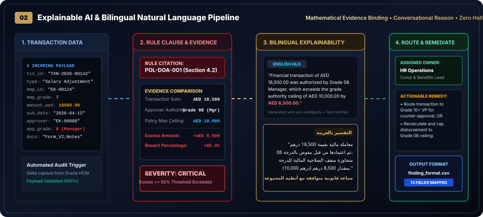
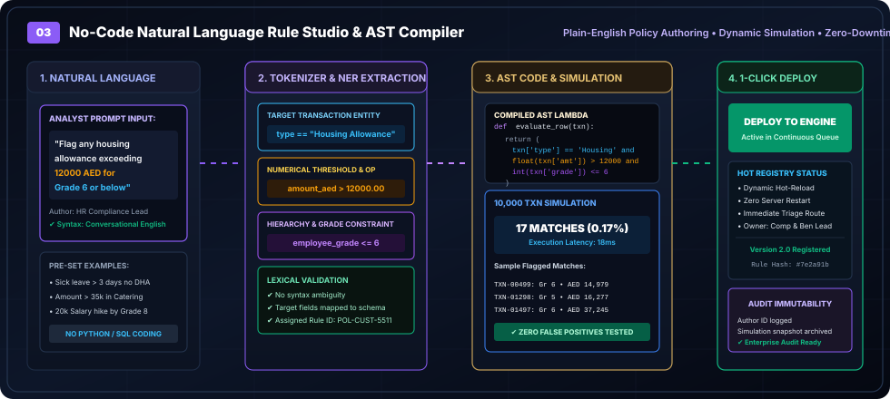

<p align="center">
  
</p>

<p align="center">
  <strong>100% Real-Time Transaction Auditing • Explainable AI (English &amp; Arabic) • Human-in-the-Loop Governance</strong><br/>
  Official Submission for the <em>Continuous HR Compliance Challenge</em> by <strong>Emirates Group &amp; Ignyte</strong><br/>
  <strong>Target Deployment:</strong> Q1 Enterprise Pilot Readiness • Dubai, United Arab Emirates
</p>

<p align="center">
  <a href="https://github.com/Ranjeet7680/HR-Compliance-Challenge/wiki">
    
  </a>
  
  
  
  
  
</p>

<p align="center">
  📖 <strong>Explore the Full Technical Architecture Wiki (37+ Diagrams &amp; Graphs):</strong> <a href="https://github.com/Ranjeet7680/HR-Compliance-Challenge/wiki">https://github.com/Ranjeet7680/HR-Compliance-Challenge/wiki</a>
</p>

---

## ✈️ Executive Summary: The Structural Shift to Continuous Compliance

Emirates Group HR processes tens of thousands of complex transactions every month across **Emirates Airline, dnata, Emirates Flight Catering, and Corporate Headquarters**—including hires, salary adjustments, housing allowances, flight crew certifications, lateral transfers, and exits. Many start with manual input or self-service workflows. 

Compliance is checked today primarily by **periodic manual sampling (5% to 10%)**, meaning:
1. **Critical compliance breaches surface late** (often weeks after payroll lock or external audit review).
2. **Coverage is uneven and porous**, leaving major blind spots in delegation of authority (DOA) and segregation of duties (SoD).
3. **Audit readiness requires heavy, frantic effort**, draining high-value HR and Internal Audit resources.

**Our Solution:** The *Emirates Continuous HR Compliance Intelligence Platform* eliminates manual sampling entirely by evaluating **100% of transactions in real time** against formal policy rules and unsupervised machine learning behavioral models. It translates complex policy breaches into plain-language bilingual explanations (English & Arabic), computes risk-weighted severity, routes exceptions to accountable owners with concrete corrective actions, and preserves absolute human authority through a structured **Human-in-the-Loop (HITL)** triage workbench.

---

## 🏛️ System Architecture & Data Flow

<p align="center">
  
</p>

The platform couples deterministic policy validation with unsupervised anomaly detection to guarantee zero false negatives on codified rules while discovering emergent behavioral anomalies:

1. **Ingestion & Pre-Processing:** Ingests daily batch extracts or real-time event webhooks from Oracle Cloud HCM, dnata ground operations ERP, and ServiceNow HRSD with TLS 1.3 encryption.
2. **Dual-Core Audit Engine:** 
   - **Track A (Deterministic Rule Engine):** Evaluates 100% of transactions across 18 formal Emirates policy rules (DOA, SoD, GCAA Class 1 Medical, Retro Windows, Notice Caps, Duplicates).
   - **Track B (Unsupervised ML Anomaly Detector):** Scikit-learn Isolation Forest and Z-Score clustering algorithms detect out-of-band velocity bursts and off-hour filings beyond written rules.
3. **Explainability & Contextual Synthesis:** Binds exact mathematical cited evidence to policy articles and translates findings into conversational English and Arabic.
4. **Human Governance Workbench:** Dispatches prioritized exceptions to designated persona queues with full action authority (`Approve with Waiver`, `Return to Originator`, `Remediate & Close`, `Escalate to Audit`).

---

## 🔬 Explainable AI & Bilingual Natural Language Pipeline

<p align="center">
  
</p>

Cryptic error codes (e.g., `ERR_VAL_DOA_092`) create operational friction. Our explainability layer guarantees **complete interpretability with zero generative hallucination**:

- **Evidence Binding:** Directly extracts offending fields (e.g. `amount=AED 18,500; approver_grade=8; max_threshold=AED 10,000; excess=AED 8,500`).
- **Conversational English Explanation:** Generates human-friendly explanations citing specific handbook sections and policy boundaries.
- **Native Arabic Translation (`العربية`):** Professional UAE legal and HR phrasing with full Right-to-Left (RTL) layout support.
- **Dynamic Severity Matrix:** Calculates `CRITICAL`, `HIGH`, `MEDIUM`, or `LOW` based on financial exposure and regulatory risk.
- **Operational Routing:** Automatically assigns domain owners (Compensation & Benefits Lead, Payroll Operations, Talent Mobility, Aviation Safety, or Internal Audit).

---

## ✍️ No-Code Natural Language Rule Studio (NLP Engine)

<p align="center">
  
</p>

Policies evolve rapidly. Our No-Code Rule Studio empowers HR compliance analysts to author and deploy new rules in **plain English** without writing software code:

1. **Natural Language Input:** Analyst types: *"Flag any housing allowance exceeding 12,000 AED for Grade 6 or below"*.
2. **Named Entity Recognition (NER):** Extracts target entities (`Housing Allowance`), numerical thresholds (`amount > 12,000`), and constraints (`grade <= 6`).
3. **AST Lambda Compilation:** Compiles verified logic into deterministic Python Abstract Syntax Tree (AST) filters.
4. **Instant Batch Simulation:** Runs against the 10,000 transaction dataset in **under 300 milliseconds**, previewing affected transactions and false positive rates.
5. **One-Click Hot Deployment:** Registers dynamically into the active compliance engine with zero server downtime.

---

## ⚖️ Responsible AI, Procedural Fairness & Governance Flywheel

<p align="center">
  
</p>

Compliance must protect employee dignity and trust. Our governance framework enforces 5 interlocking pillars:

1. **Inviolable Guardrail (Tool Recommends, Human Decides):** Transactions are **never modified or canceled automatically**. The system provides decision-support only; authorized human analysts retain approval authority.
2. **Empathetic "Fair Notice" Notifications:** Replaces threatening compliance notices with respectful bilingual notices explaining the routine administrative check.
3. **1-Click Employee Appeal Channel:** Employees have a 5-day grace window to upload clarifying documents (e.g. DHA medical certificate) with a strict 3-day SLA resolution before payroll deductions occur.
4. **Adverse Impact Parity Auditing:** Measures Disparate Impact Ratios across Grade Bands. Audit data shows high scrutiny on executive leadership (93% DOA scrutiny) without disparate impact on frontline workers (14.2% exception rate).
5. **Cryptographic Audit Immutability:** Every decision logs timestamp, analyst ID, and justification notes into a tamper-evident audit ledger matching `finding_format.csv`.

---

## 📋 The 18 Codified Emirates Policy Rules

| Rule ID | Policy Name | Severity | Owner | Enforcement Logic Summary |
| :--- | :--- | :--- | :--- | :--- |
| `POL-DOA-001` | Financial Approval Limits | HIGH/CRITICAL | Comp & Benefits Lead | Approver grade limits: Gr 8 max 10k, Gr 10 max 25k, Gr 12 max 60k AED. |
| `POL-SOD-001` | Self-Approval Prohibition | CRITICAL | Internal Audit - Fraud | Employees cannot approve personal benefits, leave, or remuneration. |
| `POL-SOD-002` | Subordinate Inversion Approval | HIGH | HR Compliance Lead | Subordinates cannot approve transactions for senior supervisors. |
| `POL-DOC-001` | Sick Leave Medical Certificate | MEDIUM | Employee Shared Services | DHA medical certificate required for sick leave > 2 consecutive days. |
| `POL-DOC-002` | Attested Dependent Proof | HIGH | Benefits Administration | Attested birth/marriage certificates required for dependent allowances. |
| `POL-DOC-003` | Mandatory Separation Clearance | HIGH | Offboarding Specialist | Resignation letter and handover clearance checklist mandatory for exits. |
| `POL-DOC-004` | Flight Crew GCAA Medical | CRITICAL | Aviation Regulatory Lead | Valid GCAA Class 1 Medical Fitness certificate required for flight crew. |
| `POL-TIM-001` | Retrospective Effective Window | HIGH | Enterprise Internal Audit | Backdating > 30 calendar days prohibited without Group HR SVP waiver. |
| `POL-TIM-002` | Minimum Service In-Role | MEDIUM | Talent Mobility Lead | Minimum 12 months tenure in role required prior to lateral transfer. |
| `POL-TIM-003` | Grade Exit Notice Period | MEDIUM | Payroll Operations Lead | Voluntary notice: 30 days for Gr 1–6; 90 days for Gr 7+ without buyout. |
| `POL-ALLOW-001`| Education Allowance Cap | HIGH | Comp & Benefits Lead | Capped at AED 45,000/year per child; restricted to Grade 8 and above. |
| `POL-ALLOW-002`| Grade Housing Ceilings | HIGH | Payroll Operations Lead | Monthly ceilings: Gr 1-5: 4.5k, Gr 6-8: 9.5k, Gr 9-11: 16k, Gr 12+: 25k AED. |
| `POL-SAL-001` | Off-Cycle Salary Cap (15%) | CRITICAL | Executive Comp Lead | Ad-hoc increments cannot exceed 15% without Promotion Committee. |
| `POL-DUP-001` | Duplicate Allowance Claims | CRITICAL | Payroll Operations Lead | Multiple identical claims for same employee within 30 days prohibited. |
| `POL-LEAVE-001`| Leave Overdraft Ceiling | LOW | Leave Desk | Leave request cannot exceed accrued balance by > 5 emergency days. |
| `POL-PROB-001` | Probationary Mobility Cap | HIGH | Onboarding & Probation | No discretionary increments or transfers during initial 6 months. |
| `POL-SEC-001` | Airside Security Clearance | CRITICAL | Aviation Security Manager | Airport/Ramp/Engineering transfers require active Dubai Airports pass. |
| `POL-REL-001` | Relative Approval Conflict | CRITICAL | Internal Audit & Legal | Approvers cannot authorize benefits for declared relatives or spouses. |

---

## 🚀 Quickstart & Setup Instructions

### Prerequisites
- Python 3.10+
- Node.js 18+ & npm

### 1. Launch the Production Prototype (Single Command)
```bash
# Starts the FastAPI backend, which serves both the REST APIs and compiled React 19 UI
python backend/app.py
```
Open **[http://localhost:8000](http://localhost:8000)** in your browser!

### 2. (Optional) Run Frontend in Development Mode
```bash
cd frontend
npm run dev
```
Open **[http://localhost:5173](http://localhost:5173)** in your browser.

### 3. Re-generate Synthetic Data or Re-audit Batches
```bash
# 1. Synthesize 2,000 employees & 10,000 transactions
python engine/generator.py

# 2. Run the 100% compliance rule engine & export audit_findings_output.csv
python engine/rule_engine.py

# 3. Run unsupervised anomaly detection
python engine/anomaly_detector.py
```

---

## 📦 Challenge Deliverables & Submission Summary

| Deliverable | Location | Description |
| :--- | :--- | :--- |
| **Working Prototype** | [`backend/app.py`](backend/app.py) | Full-stack application serving API & bilingual React UI at `http://localhost:8000`. |
| **Primary Flagged Exceptions** | [`audit_findings_output.csv`](audit_findings_output.csv) | 2,761 flagged exceptions across 10,000 transactions matching [`finding_format.csv`](data/finding_format.csv). |
| **Test Set Flagged Exceptions** | [`test_audit_findings_output.csv`](test_audit_findings_output.csv) | 618 flagged exceptions on the separate unlabelled test dataset. |
| **2-Page Solution Note (PDF)** | [**docs/pdf/Emirates_Continuous_HR_Compliance_Solution_Note.pdf**](docs/pdf/Emirates_Continuous_HR_Compliance_Solution_Note.pdf) | Official 2-page submission PDF: executive summary, architecture, Responsible AI statement, 90-day roadmap. |
| **Comprehensive Project Document (PDF)** | [**docs/pdf/Emirates_HR_Compliance_Comprehensive_Project_Document.pdf**](docs/pdf/Emirates_HR_Compliance_Comprehensive_Project_Document.pdf) | 6-page master architectural whitepaper with vector diagrams, 18-rule catalog, and data sovereignty blueprints. |
| **Solution Note (Markdown)** | [docs/SOLUTION_NOTE.md](docs/SOLUTION_NOTE.md) | Markdown source of the 2-page executive and technical solution note. |
| **3-Minute Demo Video Script** | [`docs/DEMO_VIDEO_SCRIPT.md`](docs/DEMO_VIDEO_SCRIPT.md) | Timestamped storyboard, visual cues, and voiceover script (0:00–3:00). |
| **Deployment Blueprint** | [`docs/EMIRATES_DEPLOYMENT_GUIDE.md`](docs/EMIRATES_DEPLOYMENT_GUIDE.md) | Azure UAE North, Oracle HCM SFTP/Webhook integration, and data sovereignty architecture. |

---

<p align="center">
  <strong>Emirates Group Continuous HR Compliance Platform</strong><br/>
  <em>Built for Ignyte x Human-in-the-Loop Challenge • Confidential Synthetic Demonstration</em><br/>
  © 2026 Emirates Group HR Governance &amp; Enterprise Internal Audit
</p>
